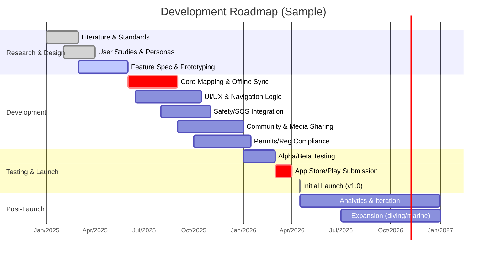

# Executive Summary  
Outdoor adventure apps unite navigation, safety, media, and community features for hikers, bikers, campers, divers, and vloggers.  Such an app must offer robust offline maps and route planning (e.g. AllTrails’ “Explore without service with map downloads”), GPX/KML import/export (GPX is the de‑facto open standard for GPS tracks), and sensor-driven guidance (turn-by-turn voice navigation and offline mapping as in Komoot).  It should support content creation and sharing – e.g. recording activity stats, photos, reviews and social sharing – while enabling emergency comms (SOS via satellite or mesh radio) and permit management (e.g. many parks now require digital permits).  We benchmark existing apps (AllTrails, Komoot, Gaia, Strava, etc.) and standards (GeoJSON, OpenStreetMap data license, RFCs) to propose a full blueprint: user personas, detailed feature sets, system architecture (mobile clients, backend/cloud sync, P2P/mesh options), required sensors (GNSS, barometer, compass, dive-computer integration), UX flows, privacy/security (encrypted data, GDPR), legal/env compliance (permits, Leave‑No‑Trace), accessibility (WCAG), localization, testing, deployment, and business model (freemium, subscriptions, affiliate/ads).  Comparison tables and diagrams (mermaid) illustrate platform choices and timelines. The result is an analytical, extensible design for a 1000+‑page adventure-app specification.  

## User Personas  
- **Adventure Vlogger.**  A content creator who documents trips via photos/videos and needs seamless media capture (geotagged photos, compass-heading, timestamp, as in the open-source OpenCamera app) and high-bandwidth comms (live streaming).  They want easy editing, filters, and social/media integration (YouTube/Instagram).  They may monetize via subscriptions or sponsored content (as suggested by a travel-vlogger app builder: “Monetize your travel experiences with premium subscriptions”).  Key needs: high-quality camera support, geo-tagging, mobile editing, fast uploads (when online), and integration with platforms (Instagram, TikTok).  

- **Solo Adventurer.**  An individual trekker or biker going off-grid.  Priorities are route planning and self-reliance.  Needs: offline multi-modal maps (topo, satellite, trails), reliable GNSS navigation, breadcrumb trails, weather updates, emergency SOS (satellite text, SMS), and gear checklists.  They expect itinerary sharing (to friends/family), check-in timers, and navigation instructions.  For safety, they may have satellite communicators (e.g. Garmin inReach) paired to the app.  They appreciate community route libraries (AllTrails’ 500k trails) and minimal distractions.  

- **Group Leader.**  An organizer of group hikes, mountain bike tours, or club outings.  Needs: schedule planning, shared routes, group location tracking, and communication (messaging, alerts).  Tools for managing event calendars, attendance, and equipment.  For example, SportEasy’s hiking app highlights “Calendar, summons, messaging” to simplify group coordination.  The leader needs to push notifications (trail conditions, meeting points), integrate GPX routes for the entire group, and possibly a P2P/local-network mode (e.g. Bluetooth) to keep the group connected even without cell service.  

- **Safety Officer.**  Often in organized expeditions or institutional settings, focusing on risk management.  Needs: real-time monitoring of all participants’ locations and vitals, SOS alerts (one-tap emergency), and offline-capable emergency comms.  Ensures compliance with permits/regulations.  Uses geo-fences and expected-return timers to trigger alerts.  May require the app to collect statistical activity logs for review.  Also concerned with legal liabilities, so privacy controls and consent (e.g. opt-in location sharing) are crucial.  

## Detailed Feature Set  

### Offline & Online Mapping and Navigation  
- **Offline Maps.**  Support downloading of maps and trails for use without connectivity.  Use open data (OSM/Topo) to avoid high licensing costs (subject to ODbL share-alike licensing).  Implement MBTiles or vector tiles cache.  For example, AllTrails Plus lets users download “maps for trails, parks, and entire areas”; Gaia GPS advertises “Offline maps to download anytime”.  Offer multiple map layers: topographic, satellite, terrain, trail, marine (for boating/fishing), and indoor (e.g. caves).  
- **Route Planning.**  In-app route editor with GPX/KML support.  Import/export standard GPX (GPS Exchange Format) tracks and waypoints and KML overlays.  Allow users to draw routes, set waypoints (camp, waterfall, fishing spots), and compute distance/elevation.  Provide turn-by-turn navigation (voice guidance on mobile/CarPlay/Bluetooth headsets) with rerouting for bikes and cars.  Komoot’s web/app suggests “sports-specific routes” for road bikes, MTB, hiking with offline voice nav.  Integrate elevation data (barometric and DEM) for accurate profiles.  
- **Real-Time Navigation.**  Use GNSS (GPS/GLONASS/Galileo) with high-accuracy mode (support WAAS/EGNOS).  Offer heads-up navigation view (3D tilt, compass overlay).  “Wrong-turn alerts” or off-route alarms should warn users (AllTrails implements this for safety).  On mobile or wearables (Apple Watch/Wear OS) show key stats and next turn.  
- **Points of Interest & Layers.**  Show POIs: campsites, water sources, trailheads, viewpoints.  Import or crowdsource POI libraries (e.g. OpenStreetMap amenities, iNaturalist spots).  Allow user-generated POIs (markers).  Integrate condition layers: weather radar, satellite imagery, avalanche forecasts.  AllTrails provides live trail conditions and environmental data.  Support geo‐fencing (alert on entering hazardous zones or protected areas).  
- **Offline & Online Sync.**  Store map tiles, GPX trails, user data locally with encrypted storage.  When online, sync completed tracks and photos to cloud.  Use conflict resolution if multiple devices (or P2P sync over Bluetooth for offline groups).  Data model to handle time-series GPS tracks, photo metadata, user notes.  

 *Illustration: The Gaia GPS app (iOS/Android) shows downloadable topographic maps and an Appalachian Trail route.  Multi-layer offline maps (contour, satellite, trails) with waypoints are essential for backcountry navigation.*  

### Activity Tracking & Media Capture  
- **Activity Recording.**  Log routes, distance, speed, elevation gain.  Use phone sensors (GNSS, accelerometer) and allow pairing with smartwatches or bike sensors (Bluetooth HR, cadence).  Offer background recording and battery-saving modes.  AllTrails and Strava style analytics (split pace, total ascent).  Save to GPX/log file.  
- **Geotagged Media.**  Integrate with the device camera to capture geo-referenced photos/videos.  Automatically embed GPS coordinates, altitude, and compass heading into EXIF (OpenCamera, an open Android camera app, tags GPS and compass data).  Allow in-app camera with overlays (altitude, depth for diving, fish finder info).  Media to auto-tag with location (waterfall, summit) and link to trail segments.  
- **Auto-Tagging & Recognition.**  (Advanced) Use AI to recognize landmarks (famous peaks, plants, fish species) from photos.  Auto-generate trip captions.  This aids vloggers and also can help with environmental education (e.g. identify flora/fauna along trail).  
- **Sharing & Community.**  Enable easy sharing of finished activities to social media and in-app feed.  E.g., AllTrails invites users to “Relive every adventure with recaps and sharing” and “Share on Facebook/Instagram”.  Implement in-app community: posts of trail reviews, trip reports, photos, and Q&A forums.  Leaderboards or badges can gamify usage.  Komoot’s interface highlights “share your adventure’s best moments with the largest outdoor community”.  Support privacy settings (private trips vs shared).  

### Safety & Emergency Features  
- **SOS/Emergency Alert.**  One-touch SOS to designated contacts and authorities, sending GPS location and medical info.  Support satellite messaging devices (Garmin inReach, SPOT, ZOLEO) integration via Bluetooth, to send texts/SOS when off-cell.  Possibly leverage emerging smartphone satellite APIs (some phones now support satellite SOS) or built-in analog comms (LoRa, two-way radio pairing).  
- **Check-in & Geo-fence.**  Users set an expected return time or checkpoints; if missed, alert contacts.  Group leaders can issue muster alerts (“Check status”).  Integrate with “geo-escape” zones: if someone leaves a planned route or a safe area, send warning.  
- **Offline Mesh Chat.**  (Optional) Use peer-to-peer mesh networking (Bluetooth or WiFi-direct) for group chat/data sync when out of range.  Research such as FireChat or Mesh networks in wildfires shows viability for basic messaging without infrastructure.  
- **Dive-Specific Safety.**  For scuba: Include integrated dive computer support.  Many dive watches/computers sync logs via BLE to apps.  Support NDL (no-deco limits), ascent rate alarms, and decompression stop timers.  Display gas mixture, tank PSI if device provides.  (No authoritative API standard, but Suunto/Garmin apps exist.)  Offline: store dive sites (latitude, max depth) and allow manual entry if needed.  

### Required Sensors & APIs  
- **GNSS (GPS/GLONASS/Galileo/QZSS/Beidou).**  Use the device’s high‑precision GPS.  Many phones support dual-frequency GNSS for improved accuracy.  Integrate e.g. Android’s FusedLocationProvider for efficient tracking, iOS CoreLocation.  Expect accuracy of ~3–10 m outdoors.  
- **Barometer.**  Many phones include a barometric sensor for altitude detection.  Use to improve elevation accuracy (especially under canopy or when GNSS vertical error is large).  
- **Magnetometer/Compass.**  For heading information (especially useful when the user is stationary to orient map).  Must calibrate (many phones auto-calibrate or prompt).  
- **Accelerometer & Gyroscope.**  For step counting, orientation, and possibly activity recognition (movement patterns).  Can detect falls or sudden stops.  Helps dead-reckoning when GNSS signal lost (e.g. caves).  
- **Camera & Microphone.**  For media capture: photos, 360° panorama, video with voice narration.  Use the Camera API with location overlays.  Also use gyroscope for VR/360 stabilization, if supported.  
- **Ambient Light & Sound (Optional).**  Could adjust UI brightness or use ambient noise as a cue (e.g., silence detection for potential emergencies).  
- **Satellite Communication Module.**  If the phone has built‑in satellite modem (some upcoming devices do), use its API for SOS texts.  Otherwise integrate with external devices (needs companion app or Bluetooth API).  
- **Bluetooth/ANT+.**  To pair external sensors: heartrate monitors, bike speed/cadence sensors, cameras, dive computers.  E.g., Apple HealthKit or Android Bluetooth LE for sensor data.  
- **Dive Computer API.**  (Proprietary) Many dive computers allow BLE pairing (e.g. Shearwater, Suunto, Garmin).  They often publish dive logs in specific formats (UDDF, etc.).  The app should import logs and display dive profile.  

### User Experience & Flows  
- **Onboarding.**  Guided setup: select persona (adventurer, vlogger, etc.), default preferences (units, activities).  Request permissions: location (fine), camera, storage, Bluetooth.  Show tutorial highlighting safety features.  
- **Home/Dashboard.**  Map-centric home screen with quick actions: “Plan New Trip,” “Record Activity,” “Offline Maps,” “SOS.”  Also upcoming trips, weather snapshot.  
- **Trip Planning Flow.**  User searches an area or trail, or imports GPX.  They can edit route, add POIs (campsite, waterfall), set waypoints.  Option to share plan with contacts.  If permits are required (e.g. trail in a National Park), the app warns and links to permit sites (as Zion’s site notes for Angels Landing).  Finally, “save to trips.”  
- **Activity Recording Flow.**  Starting a hike/bike ride: tap “Record.”  The app logs GPS track, shows elapsed time, distance, elevation graph.  Provide quick-report: “pause,” “mark waypoint,” “take photo,” “send ETA.”  On completion, show statistics and allow review/edit of GPX.  Then prompt to save/share to feed.  
- **Emergency Flow.**  Prominent SOS button.  On activation, confirm and then alert pre-set contacts with live location.  Also send to emergency services if possible.  Include optional personal medical profile (allergies, blood type).  
- **Media & Sharing Flow.**  Gallery of user’s posts: scrollable feed.  Create a “Story” by selecting map + photos + text.  Share to external social networks or save video.  Notifications for comments/likes and new trail suggestions.  
- **Settings & Profile.**  Manage account, subscription, units, offline map storage, privacy (which data is shared).  Access FAQs for gear (like LNT guidelines) and integration settings (connect to camera, Garmin Connect, etc.).  

## Privacy, Security & Compliance  
- **Data Privacy.**  Follow GDPR/CCPA for personal data.  Only collect location with permission, allow users to delete their data.  AllTrails explicitly notes “Data is encrypted in transit” and allows deletion; Gaia GPS similarly encrypts data.  Use end-to-end encryption for personal info.  Anonymize aggregated route data if shared.  
- **Authentication.**  Support email/password and OAuth (Google, Apple Sign-In).  Offer guest mode with local-only data (no cloud).  If social sharing is enabled, ask explicit opt-in.  
- **Safety & Liability.**  Include disclaimers (“hike at your own risk”).  Possibly implement a “digital waiver” that users accept (especially for guided groups).  Comply with local laws about sharing location (e.g., some countries restrict map/personal data exports).  
- **Map Data Licensing.**  If using OpenStreetMap (ODbL), display attributions and share-alike any derived data.  If using third-party tiles (Google, Mapbox, HERE), adhere to their TOS (often forbid storing tiles offline outside their SDK).  Consider buying or licensing global datasets (like USGS for topo, NOAA for marine charts).  
- **Environmental Compliance.**  Integrate “Leave No Trace” tips (NPS lists 7 principles) into UI.  Warn users about protected zones or dangers (e.g. wildfire alerts).  If fishing, include regulations or catch limits from regional databases.  Use altitude safety: warn about avalanche risk via NOAA/NWS feeds if in winter mountains.  

## Accessibility & Localization  
- **Accessibility.**  Follow WCAG guidelines for color contrast, text size, and labels.  Provide voice commands and screen-reader compatibility for key functions (e.g. “Start hike,” “SOS”).  High-contrast map modes for low-vision.  Map styles suitable for color-blind users.  Use large touch targets in the field (gloved hands).  Komoot’s spoken navigation aids partially fulfill this.  
- **Localization.**  Support multiple languages (English, Spanish, French, etc.).  Automatically translate UI via i18n framework; allow user-generated content to have language tags.  Ensure units (km/mi, meters/feet) adapt to locale.  Handle RTL languages if needed.  Date/time formats respect user region (vital for planning schedules).  

## Technical Architecture  

```mermaid
flowchart LR
    subgraph "Mobile Client"
      A[UI/UX Layer] --> B[Local DB (SQLite/Realm)]
      B --> C{"Connectivity?"}
      C -->|Online| D(Backend API)
      C -->|Offline| E(P2P/Mesh)
      A --> F[Sensors (GPS, Barometer, Compass, Camera)]
      A --> G[Local Services: Media, GPX Import/Export]
    end
    subgraph "Cloud Backend"
      D --> H((Auth Server))
      D --> I[(GeoData APIs/Maps)]
      D --> J[(User & Trip DB)]
      D --> K[(Messaging/SOS Server)]
      D --> L[(Payment & Subscription)]
      J -.-> M[(Analytics/ML Server)]
    end
    H --- J
    I --- J
    K --- D
    L --- J
    subgraph "External Services"
      I -. "Map & Weather APIs" .-> I
      N[Satellite Network / Cell Towers] -- SMS/Alerts --> A
    end
```

This architecture envisions **mobile apps** (iOS/Android/PWA) as the primary client, using local storage (SQLite or Realm) for offline data (maps, tracks, cached API data). On **online**, the mobile app syncs with the cloud via REST/GraphQL APIs: an **Auth server** for login, a **Map/GeoData API** (could be Google Maps, Mapbox, OSM services) for base maps, a **User/Trip database** (cloud DB) to store profiles, shared routes, community content, and a **Messaging/SOS backend** for alerts (possibly integrated with SMS gateways or satellite webhook). **Payment/subscription** is managed via platform stores (Apple/Google) or integrated Stripe. Sensor data flows from the device (GNSS, barometer, camera) to the app UI. In *offline mesh mode*, local P2P can allow devices to share location/status.  

### Data Models (example)  
- **User**: id, profile, gear (bike/car models), preferences, contacts (for emergency).  
- **Persona Profile**: tags (vlogger/adventurer), permissions (photo share, SOS).  
- **Trip/Activity**: id, owner, type (hike/bike/dive), date, GPX track, distance, ascent, photos, notes, public/private.  
- **Route**: planned path (GPX/KML), waypoints, POIs, associated permit id if needed.  
- **Permit**: id, issuing agency, trip reference, expiration.  
- **Sensor Log**: time-series (GPS lat/lon/alt, bearing, temperature).  
- **Media**: images/videos with metadata (GPS, timestamp, caption, tags).  
- **Community Post**: user, media, text, location, likes, comments.  

## Feature Comparison of Existing Apps  

| Feature / App      | AllTrails (hiking) | Komoot (bike/hike) | Gaia GPS (hike/camp) | Strava (fitness)    | OSMAnd (open-source) |
|--------------------|-----------------------------------------------|-----------------------------------------------|--------------------------------------------------|--------------------|----------------------|
| **Offline Maps**   | Yes (with subscription)        | Yes (with subscriptions for regions) | Yes, downloadable topo/maps          | Limited (strava only caches recent segment) | Yes, fully offline |
| **Route Planning** | Custom & Save routes, driving directions | Sports-specific route generation       | Point-to-point routing, trail discovery | Route importer only | DIY routing & GPX import |
| **Voice Nav**      | No (map-based guidance)                        | Yes (turn-by-turn voice)           | Yes (GPS nav; terrain-aware)          | Yes (turn-by-turn phone nav) | No (map-only)       |
| **Activity Track** | Yes (distance, elevation, timing) | Yes (record stats, upload)                         | Yes (GPS track, weather)             | Yes (focus fitness metrics) | Basic GPX tracks |
| **Community**      | Trail reviews, shared photos    | Route sharing, photos             | Forum + shared trips (less focus)                | Friends/segments    | Open map editing community |
| **SOS/Check-in**   | Live tracking share; no built-in SOS | No built-in SOS (rely on phone)                   | No built-in SOS (uses phone/GPS)                   | Beacon/Strava Live (premium) | None                   |
| **Sensor Support** | GPS, compass, altimeter via phone               | GPS, altimeter; can use smartphone sensors        | GPS, barometer, compass; external sensors (via devices) | GPS, heart-rate (BLE) | GPS, compass, optional sensors |
| **Monetization**   | Freemium (AllTrails+ sub, ads)    | Subscription for regions/trails                   | Freemium (Outside+ sub, ads)       | Freemium+ (premium features) | One-time purchase/Donations |
| **Platforms**      | iOS/Android/Web                                | iOS/Android/Web                                 | iOS/Android/Web                                   | iOS/Android        | iOS/Android/Linux    |  

*Table: Comparison of popular outdoor adventure apps and their capabilities.  (Sources: app descriptions.)*  

## Technical Stack & Trade-offs  
- **Mobile Frontend:** Likely cross-platform (React Native, Flutter, or native Swift/Kotlin).  Use a robust mapping SDK (Mapbox GL, ESRI, or Apple/Google Maps for visuals).  High-performance rendering of vector maps is needed for offline.  
- **Backend:** Cloud platform (AWS/GCP/Azure) with microservices.  Use PostgreSQL/PostGIS for geodata.  REST or GraphQL APIs.  Consider GIS servers for custom map tiles (TileServer GL).  Real-time features (messaging/SOS) via WebSockets or push.  
- **Offline Mesh:** Implement local peer discovery with Bluetooth/Wi-Fi Direct to share location and short messages.  Trade-off: range is limited (Bluetooth ~100m); battery vs connectivity.  
- **Satellite Comms:** Integrate APIs from satellite providers (Iridium GO!, Spacetel, etc.).  Possibly incorporate new standards like SBAS for GPS correction.  
- **Data Volume:** Caching tiles offline requires storage (e.g. 500MB for region).  Balance tile resolution vs map clarity.  Use vector tiles to minimize size and allow styling changes.  
- **Third-Party APIs:** Weather (NOAA/NWS, OpenWeatherMap), Land cover, avalanche forecasts.  Ensure fallback if offline (cache last data).  
- **Dive Integration:** Might rely on proprietary SDKs if available; otherwise allow manual data import (e.g., uploading .csv from dive computers).  

## Privacy & Security (Cont.)  
Ensure end‑to‑end encryption (TLS 1.3 for all server comms).  Store sensitive data (health info, location history) encrypted at rest.  Regular security audits (ISO/IEC 27001 compliance).  Follow OAuth2 for auth.  Minimal data collection: geo-privacy by design (users can disable auto-location upload).  

## Legal & Environmental Compliance  
Apps can link to official data: e.g., NPS APIs (National Park Service) for alerts/permitting.  Recognize protected areas (Wilderness, marine reserves) and warn users (digital LNT).  In marine mode, comply with hydrographic chart standards (NOAA ENC charts).  For drone usage: if user logs drones, warn of no-drone zones.  Follow any regional data sovereignty laws if hosting backend in specific countries.

## Accessibility & Internationalization  
Adhere to **WCAG 2.1** for text and UI.  Provide screen-reader labels for maps (“Map showing your route, controls below”).  Ensure all buttons have text or ARIA labels (especially SOS).  Support haptic/vibration feedback for alerts (for hearing-impaired).  Localize UI strings via i18n; allow RTL layout.  Use timezone-aware scheduling.

## Testing, Deployment & Maintenance  
- **Testing:** Automated unit tests for logic; UI tests with emulators (Appium/XCTest).  Field-testing with actual outdoor conditions (GPS loss, low battery).  Beta user feedback (via TestFlight, Play Beta).  Crowdsourced testing for translation accuracy.  
- **CI/CD:** Streamlined pipeline (GitHub Actions, Bitrise) to build iOS/Android/Web.  Use feature flags to gradually release new features (Permits, P2P).  Monitor crashes (Crashlytics) and performance.  
- **Monitoring:** Analytics on feature usage (respecting opt-in), server health, map tile requests.  Track off-grid usage patterns to improve offline caching (e.g., frequently downloaded areas).  

## Business Model & Monetization  
Freemium subscriptions are standard: tiered plans unlocking offline maps, advanced planning, and safety tools.  AllTrails sells “Plus” and “Peak” subs (with offline maps, wrong-turn alerts).  Gaia offers “Outside+” (300+ maps, offline, weather layers).  Vlogger-focused premium content (exclusive guide videos, tutorials) can be sold via in-app subscriptions.  Additional revenue from affiliate partnerships (outdoor gear, guidebooks), in-app ads (sparingly for free users), and data licensing (aggregated trail usage to parks or advertisers).  Non-profit ties: like AllTrails’ donation (“1% for the Planet”), or conservation fundraising via the app.  

## Roadmap & Timeline  



This timeline is illustrative.  After launch, ongoing updates will add modules (e.g. scuba diving features, new sensor support) based on user feedback and tech advances (e.g. smartphone satellite communication).  

## Conclusion  
This blueprint outlines a **comprehensive adventure app** integrating navigation, safety, social, and media features.  By combining proven elements from existing apps with rigorous standards (GPX/KML, IETF GeoJSON, ISO safety regs), and accounting for edge cases (offline mesh, environmental laws), the design can scale into a detailed 1000+ page specification.  It balances usability (clear UX flows, personas) with technical depth (sensor fusion, cloud sync), and ensures user trust via privacy/security best practices.  The included diagrams and tables serve as templates for architects and engineers to expand each section into implementation-ready plans.  

